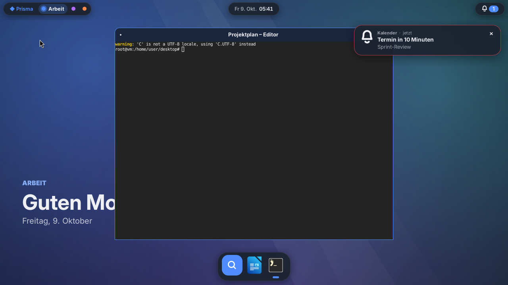
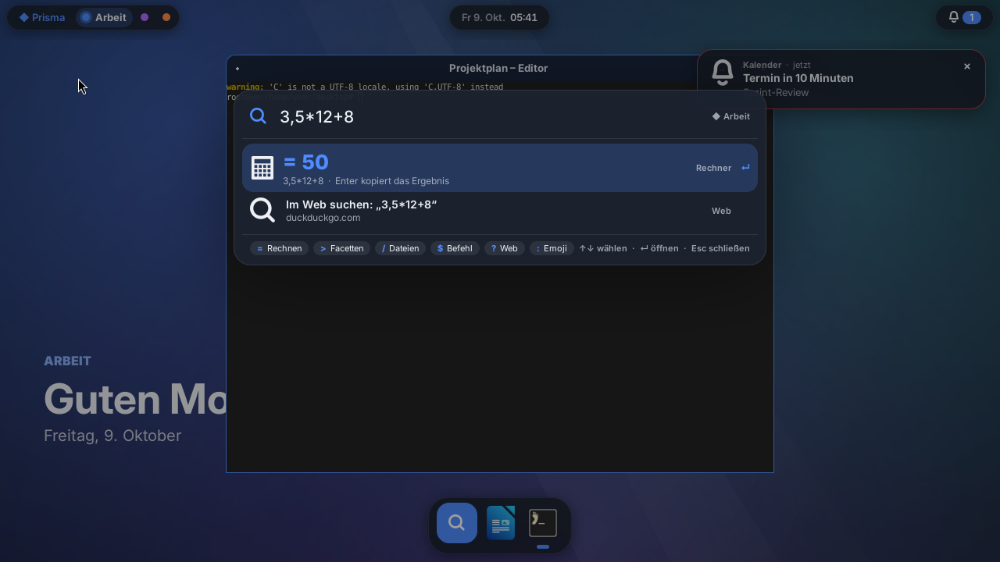
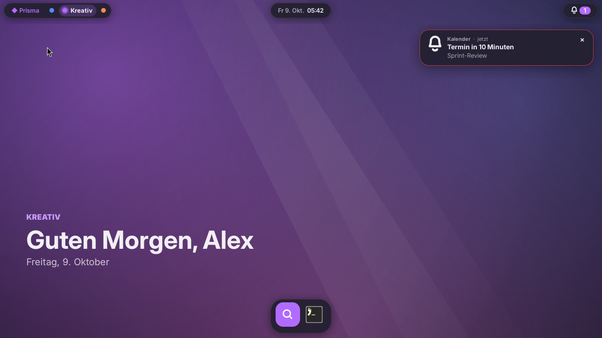
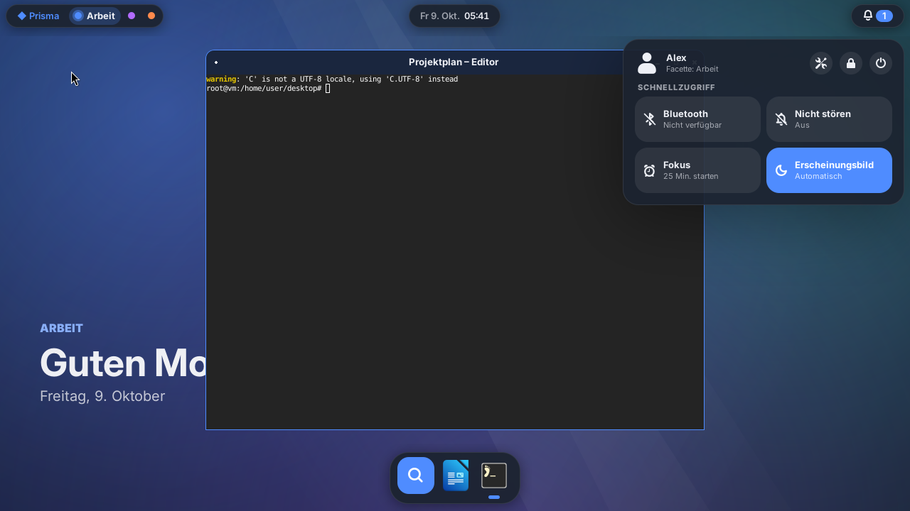
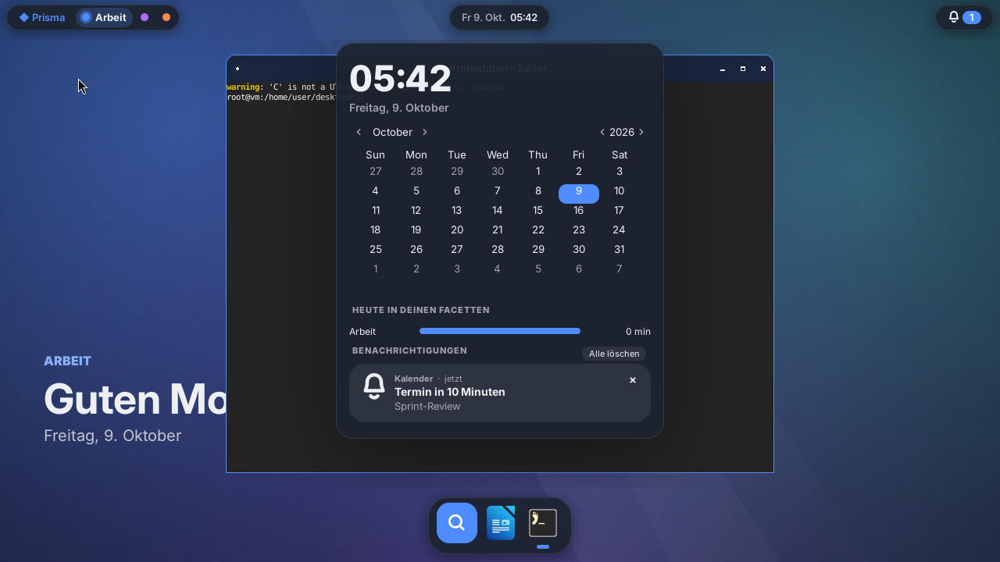
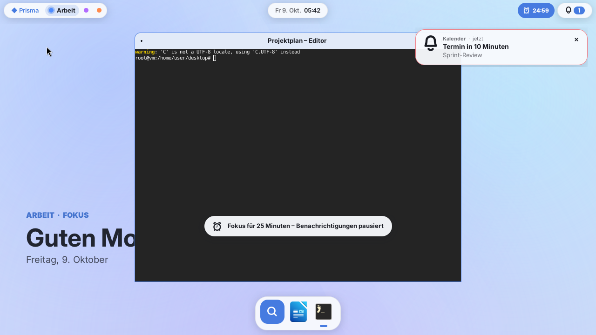
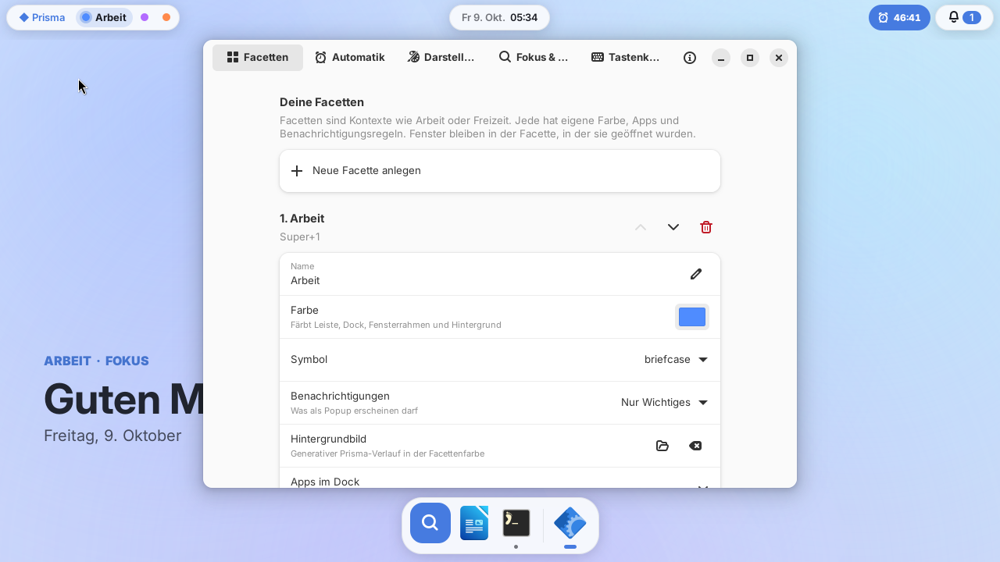

# ◆ Prisma

**Eine kontextbewusste Desktop-Umgebung für Ubuntu-basierte Linux-Distributionen.**

Prisma bricht mit der Idee nummerierter Arbeitsflächen. Stattdessen arbeitest du in **Facetten** –
Kontexten wie *Arbeit*, *Kreativ* oder *Freizeit*. Jede Facette hat ihre eigene Farbe, ihre eigenen
Apps im Dock und ihre eigenen Regeln dafür, wer dich stören darf. Ein Wechsel färbt die gesamte
Oberfläche um – Leiste, Dock, Fensterrahmen und Hintergrund – und räumt die Fenster der anderen
Facette sanft beiseite.



<table>
  <tr>
    <td></td>
    <td></td>
  </tr>
  <tr>
    <td align="center"><b>Kompass</b> – rechnet mit deutschem Dezimalkomma</td>
    <td align="center"><b>Facettenwechsel</b> – alles färbt sich um</td>
  </tr>
  <tr>
    <td></td>
    <td></td>
  </tr>
  <tr>
    <td align="center"><b>Schnelleinstellungen</b></td>
    <td align="center"><b>Tagesüberblick</b> – Zeit pro Facette & Benachrichtigungen</td>
  </tr>
  <tr>
    <td></td>
    <td></td>
  </tr>
  <tr>
    <td align="center"><b>Tageslicht-Modus</b> & laufende Fokus-Session</td>
    <td align="center"><b>Einstellungen</b> (GTK 4 / libadwaita)</td>
  </tr>
</table>

---

## Was Prisma anders macht

| | Idee | Im Alltag |
|---|---|---|
| ◆ | **Facetten statt Arbeitsflächen** | `Super+1/2/3` wechselt den Kontext. Fenster bleiben in der Facette, in der sie geöffnet wurden. Holst du ein Fenster einer anderen Facette per `Alt+Tab` nach vorn, folgt Prisma automatisch dorthin. |
| 🎨 | **Eine Farbe für alles** | Aus der Facettenfarbe entsteht eine komplette Palette – für Shell, Fensterrahmen (labwc-Thema wird live neu erzeugt) und den generativen Hintergrund, der beim Wechsel weich überblendet. |
| 🧭 | **Kompass** (`Super+Leertaste`) | Eine Eingabe für alles: Apps (lernt, was du oft nutzt), Fenster, Dateien, Rechnen (`3,5*12+8`, `20% von 150`), Einheiten (`10 km in mi`, `100 c in f`), Facetten, Systemaktionen, Befehle (`$ htop`), Websuche (`? …`) und Emoji (`: herz`). |
| 🔕 | **Benachrichtigungen mit Kontext** | Pro Facette: *alle*, *nur Wichtiges* oder *stumm*. Nichts geht verloren – zurückgehaltene Meldungen landen im Tagesüberblick. Kritische Meldungen kommen immer durch. |
| ⏱ | **Fokus-Sessions mit Rückblick** | `Super+F` startet eine Fokus-Session. Benachrichtigungen werden gesammelt, die Leiste zeigt die Restzeit, danach gibt es eine Zusammenfassung und eine Pausenerinnerung. |
| 🌗 | **Tageslicht-Modus** | Hell am Tag, dunkel am Abend – für die Shell *und* deine Apps (GTK-3/4-Farbschema wird mitgeschaltet). |
| 📊 | **Tagesüberblick** | Klick auf die Uhr: Kalender, Zeit pro Facette heute und alle Benachrichtigungen. |
| ⏰ | **Automatik** | Optional wechselt Prisma nach Zeitplan, z. B. werktags 8–17 Uhr → *Arbeit*. Manuelle Wechsel bleiben bis zum nächsten Zeitfenster bestehen. |
| 🏝 | **Insel-Dock** | Schwebendes Dock mit den Apps der aktiven Facette, laufenden Fenstern und einer Medien-Kapsel (MPRIS), die nur erscheint, wenn etwas läuft. Rechtsklick heftet an oder löst. |

## Installation

Voraussetzung: **Ubuntu 24.04 LTS oder neuer** bzw. eine darauf basierende Distribution
(Linux Mint 22, Pop!_OS 24.04, Zorin OS 18, elementary OS 8, KDE neon, Kubuntu/Xubuntu 24.04 …).

```bash
git clone https://github.com/jessehaemmerle/desktop.git prisma
cd prisma
./install.sh
```

Danach abmelden und im Anmeldebildschirm (Zahnrad-Symbol) die Sitzung **„Prisma“** wählen.

<details>
<summary>Alternativen: Debian-Paket bauen, manuell installieren, ausprobieren ohne Abmelden</summary>

**Als .deb-Paket**

```bash
sudo apt install build-essential debhelper python3-pytest
dpkg-buildpackage -us -uc -b
sudo apt install ../prisma-desktop_0.1.0_all.deb
```

**Manuell**

```bash
sudo apt install labwc python3-gi python3-gi-cairo gir1.2-gtk-3.0 gir1.2-gtklayershell-0.1 \
                 gir1.2-gtk-4.0 gir1.2-adw-1 swaylock swayidle grim slurp wl-clipboard \
                 brightnessctl fonts-inter xdg-desktop-portal-wlr xdg-desktop-portal-gtk
sudo make install            # nach /usr/local
sudo make uninstall          # wieder entfernen
```

**In der laufenden Sitzung ausprobieren** (labwc öffnet sich als Fenster):

```bash
make run
```
</details>

## Erste Schritte

| Tastenkürzel | Aktion |
|---|---|
| `Super` + `Leertaste` | Kompass öffnen |
| `Super` + `1` … `9` | Zu Facette wechseln |
| `Super` + `Tab` | Nächste Facette |
| `Super` + `Umschalt` + `1` … `4` | Aktives Fenster in eine Facette verschieben |
| `Super` + `F` | Fokus-Session starten/beenden |
| `Super` + `A` / `Super` + `N` | Schnelleinstellungen / Tagesüberblick |
| `Super` + `D` | Nicht stören |
| `Super` + `L` | Sperren |
| `Super` + `Eingabe` / `Super` + `E` | Terminal / Dateien |
| `Super` + `Q` | Fenster schließen |
| `Super` + `↑` `←` `→` | Maximieren / links / rechts andocken |
| `Druck` / `Umschalt` + `Druck` | Bildschirmfoto (ganz / Bereich) |
| Rechtsklick auf den Schreibtisch | Kompass |
| Scrollen über den Facetten / dem Status | Facette wechseln / Lautstärke |

**Kompass-Präfixe:** `=` Rechnen · `>` Facetten (inkl. „Fenster verschieben“) · `/` Dateien ·
`$` Befehl · `?` Web · `:` Emoji. `Alt+1…9` aktiviert direkt den n-ten Treffer.

## Konfiguration

Am bequemsten über **Prisma-Einstellungen** (Kompass → „Einstellungen“ oder `Super+,`).
Alles liegt in `~/.config/prisma/config.json` – die Shell übernimmt Änderungen sofort:

```jsonc
{
  "facets": [
    {
      "id": "arbeit", "name": "Arbeit", "color": "#4f8cff",
      "notifications": "important",          // all | important | silent
      "wallpaper": null,                     // oder Pfad zu einem Bild
      "pinned": ["firefox_firefox|firefox", "org.gnome.Nautilus"]   // "a|b": erste installierte gewinnt
    }
  ],
  "rules": [{ "facet": "arbeit", "days": [0,1,2,3,4], "from": "08:00", "to": "17:00" }],
  "auto_switch": false,
  "focus": { "work_minutes": 25, "break_minutes": 5, "allow_apps": ["Kalender"] },
  "appearance": { "mode": "auto", "light_from": "07:00", "dark_from": "19:00", "dock_icon_size": 44 }
}
```

Tastenkürzel, Touchpad und Fensterverhalten: `~/.config/prisma/labwc/rc.xml`
([labwc-Dokumentation](https://labwc.github.io/labwc-config.5.html)).

**Skripten:** `prisma-msg` steuert die laufende Shell, z. B.
`prisma-msg facet freizeit`, `prisma-msg focus 50`, `prisma-msg kompass "= 2^10"`,
`prisma-msg volume up` (`prisma-msg --help` zeigt alle Befehle).

## Architektur in Kürze

```
 ┌──────────────── labwc (Wayland-Compositor, wlroots) ────────────────┐
 │  Fenster · Eingabe · Dekorationen (Thema „Prisma“ wird live erzeugt) │
 └───────▲───────────────────────▲────────────────────────▲────────────┘
         │ wlr-layer-shell        │ wlr-foreign-toplevel    │ labwc --reconfigure
 ┌───────┴──────────────────── prisma-shell (Python, GTK 3) ┴────────────┐
 │ Horizont-Leiste · Insel-Dock · Kompass · Panels · OSD · Hintergrund     │
 │ Hub: Facetten · Fokus · Theme · Statistik      Benachrichtigungsdienst  │
 │ eigener Wayland-Client (reines Python)         (org.freedesktop.…)      │
 └───────▲───────────────────────────────────────────────▲───────────────┘
         │ D-Bus (org.gtk.Actions)                         │ ~/.config/prisma/config.json
   prisma-msg (Tastenkürzel, Skripte)            prisma-settings (GTK 4 / libadwaita)
```

* **Compositor:** [labwc](https://labwc.github.io) – schlank, stabil, in Ubuntu enthalten.
* **Shell:** Python + GTK 3 + gtk-layer-shell (in Ubuntu 24.04 paketiert).
* **Fensterliste:** ein kleiner, abhängigkeitsfreier Wayland-Client in reinem Python
  (`prisma/wayland/`) spricht `zwlr_foreign_toplevel_management_v1`.
* **Logik ohne GTK** (`prisma/core/`) – vollständig mit pytest getestet.

Details: [docs/ARCHITEKTUR.md](docs/ARCHITEKTUR.md).

## Entwicklung

```bash
make test                      # Unit-Tests (ohne GTK lauffähig)
tests/smoke.sh                 # startet labwc headless + Shell, erzeugt Bildschirmfotos
```

Die CI führt beides auf Ubuntu 24.04 aus und hängt die Bildschirmfotos als Artefakt an.

Projektstruktur:

```
prisma/core/      reine Logik: Facetten-Fenster, Benachrichtigungsregeln, Rechner, Einheiten,
                  Unscharfe Suche, Frecency, Paletten/CSS, Zeitpläne, Parser
prisma/wayland/   Wayland-Wire-Protokoll + Fensterliste (reines Python)
prisma/shell/     die GTK-Shell (Leiste, Dock, Kompass, Panels, Dienste)
prisma/settings/  Einstellungs-App
data/             labwc-Konfiguration, Sitzung, Portale, Icon, Startthema
bin/              prisma-session, prisma-shell, prisma-msg, prisma-settings, prisma-lock, prisma-launch
debian/           Paketierung
```

## Grenzen & Ausblick

* Unschärfe-Effekte (Blur) hinter Panels unterstützt labwc nicht – Prisma nutzt stattdessen
  leicht transparente, deckende Flächen.
* Leiste und Dock erscheinen auf dem aktiven Bildschirm, der Hintergrund auf allen.
* Bildschirmanordnung: `wdisplays` oder `kanshi` (wird automatisch gestartet, wenn konfiguriert).
* Ideen für später: Facetten-spezifische Autostart-Apps, Zwischenablage-Verlauf im Kompass,
  Übersetzungen (die Oberfläche ist derzeit deutsch).

## Lizenz

GPL-3.0-or-later – siehe [LICENSE](LICENSE).
